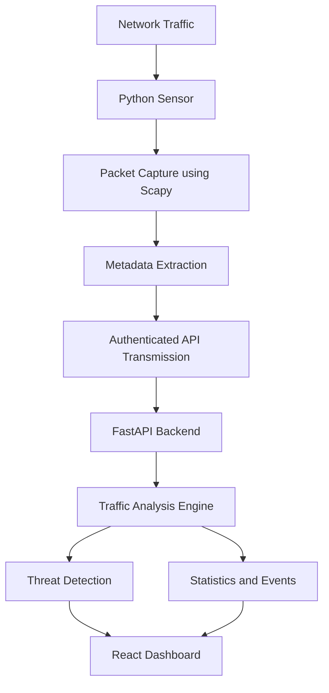

# 🛡️ Network Sentinel
### Real-Time Network Traffic Monitoring & Threat Detection System

Network Sentinel is a network security monitoring project designed to capture, analyze, and monitor network traffic in real time. It uses packet inspection and traffic analysis to identify network activity, monitor communication patterns, and generate security alerts.

The project combines a Python-based packet capture sensor, a FastAPI backend, and a React dashboard to provide centralized visibility into network traffic.

---

## 🚀 Project Overview

Network Sentinel provides visibility into network activity through packet-level monitoring and traffic analysis.

The system captures network packets, extracts relevant metadata, transmits the collected information to a backend processing engine, and presents traffic statistics through an interactive dashboard.

## ✨ Key Features

- **Real-Time Packet Capture:** Captures network packets using Python and Scapy.
- **Network Traffic Analysis:** Analyzes TCP and UDP traffic and extracts relevant packet information.
- **TCP Flag Inspection:** Monitors TCP flags such as SYN, ACK, FIN, RST, and PSH.
- **Protocol Monitoring:** Tracks network protocol distribution.
- **Port Analysis:** Identifies frequently communicating network ports.
- **IP Statistics:** Tracks source and destination IP activity.
- **Threat Detection:** Processes network activity and generates security alerts.
- **Incident Monitoring:** Provides visibility into detected security incidents.
- **Interactive Dashboard:** Displays network statistics and monitoring information.
- **Remote Sensor Communication:** Transmits captured packet metadata securely to the backend using API-key authentication.

## 🏗️ System Architecture



## 🛠️ Technology Stack

| Component | Technologies |
|---|---|
| Programming Language | Python |
| Packet Capture | Scapy |
| Backend | FastAPI |
| API Communication | REST API, HTTPX |
| Frontend | React.js |
| Build Tool | Vite |
| Styling | CSS |
| Deployment | Render |

## 📊 Dashboard Capabilities

The dashboard provides visibility into:

- Total captured packets
- TCP and UDP distribution
- TCP flag statistics
- Top network ports
- Source and destination IP statistics
- Security alerts
- Incident information
- Network monitoring status

## ⚙️ Project Structure

```text
network-sentinel/
│
├── src/
│   ├── api.py
│   ├── sensor.py
│   └── main.py
│
├── dashboard/
│   ├── src/
│   ├── public/
│   ├── package.json
│   └── vite.config.js
│
├── .venv/
├── requirements.txt
└── README.md
```

## 💻 Installation and Setup

### 1. Clone the Repository

```bash
git clone YOUR_GITHUB_REPOSITORY_URL
cd network-sentinel
```

### 2. Create a Python Virtual Environment

```bash
python3 -m venv .venv
source .venv/bin/activate
```

### 3. Install Python Dependencies

```bash
pip install -r requirements.txt
```

### 4. Configure Environment Variables

Configure the following variables in your local environment:

```env
SENSOR_API_KEY=YOUR_SECRET_API_KEY
SENSOR_API_URL=YOUR_BACKEND_URL
SENSOR_INTERFACE=eth0
```

Never commit actual credentials or secret keys to GitHub.

### 5. Start the Network Sensor

```bash
sudo --preserve-env=SENSOR_API_KEY,SENSOR_API_URL,SENSOR_INTERFACE \
.venv/bin/python src/sensor.py
```

The sensor requires appropriate network interface access and packet-capture permissions.

### 6. Start the Dashboard

```bash
cd dashboard
npm install
npm run dev
```

Open the local Vite URL displayed in the terminal.

## 🔌 Backend API Endpoints

| Endpoint | Method | Purpose |
|---|---|---|
| `/api/health` | GET | Backend health status |
| `/api/stats` | GET | Network traffic statistics |
| `/api/events` | GET | Retrieve network events |
| `/api/incidents` | GET | Retrieve security incidents |
| `/api/monitor/status` | GET | Monitoring status |
| `/api/monitor/start` | POST | Start monitoring |
| `/api/monitor/stop` | POST | Stop monitoring |
| `/api/sensor/packets` | POST | Receive sensor packet batches |

Sensor packet submission requires the configured `X-Sensor-Key` authentication header.

## 🔐 Security Considerations

- API-key authentication for sensor communication.
- Secret credentials are configured through environment variables.
- Packet payload capture is disabled in the current sensor configuration.
- Only authorized network monitoring should be performed.
- Captured network metadata should be handled responsibly.

## ☁️ Deployment

The application uses Render for backend hosting and dashboard deployment.

- Backend: Render
- Frontend: Deployed dashboard
- Sensor: Runs on an authorized network-connected machine.

**Note:** The current backend maintains monitoring statistics in memory. These statistics may reset when the backend process restarts or is redeployed.

## 🔮 Future Enhancements

- Multi-user authentication and access control.
- Persistent database storage.
- Centralized sensor deployment.
- Advanced anomaly detection using machine learning.
- Enhanced threat intelligence integration.
- Historical network traffic visualization.
- Automated security reporting.

## 👩‍💻 Author

**Kanan Kathuria**

B.Tech Computer Engineering

Interests: Cybersecurity | Network Security | Security Engineering | Digital Forensics

---

*Network Sentinel — Bringing visibility and intelligence to network security.*
